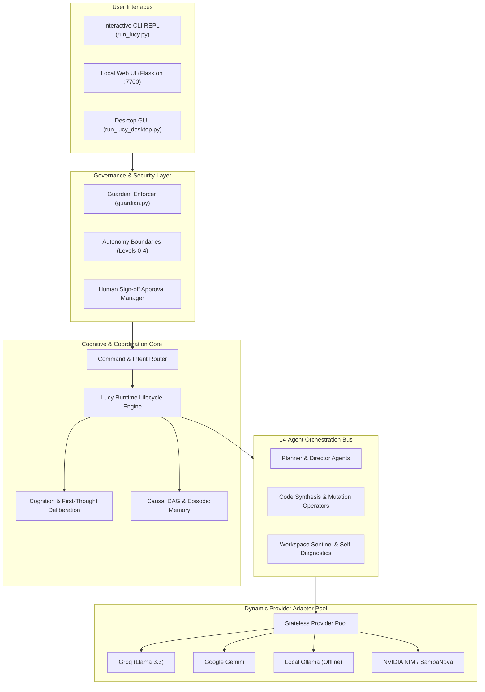

# LUCY — Autonomous AI Operating System & Cognitive Companion

<div align="center">

[](https://python.org)
[](config/spine.json)
[](backend/lucy_core/guardian.py)
[](tests/)
[](LICENSE)

**A deterministic, safety-first autonomous AI operating system designed as a modular desktop companion.**  
*Decoupling probabilistic LLM reasoning tools from system identity, persistent memory, and security governance.*

</div>

---

## 1. Executive Summary & Core Philosophy

Modern autonomous agents frequently conflate large language model (LLM) weights with agent identity, resulting in prompt injection vulnerability, catastrophic forgetting, and non-deterministic behavior.

**LUCY** solves this by establishing a **deterministic, localized operating system** where the LLM is treated as an ephemeral reasoning component rather than the agent's identity. Lucy maintains her own:
* **Living Spine (`config/spine.json`):** An immutable, transparent schema dictating permissions (Levels 0–4), identity invariants, and 14 autonomous sub-agent roles.
* **Cognitive Deliberation Layer:** First-thought hidden reasoning, temporal awareness, internal monologue, self-modeling, and epistemic provenance.
* **Provider-Agnostic Engine Mesh:** Dynamic failover across **Groq, OpenRouter, Google Gemini, SambaNova, NVIDIA NIM, and local Ollama** with zero-leak in-memory credential safety.
* **Guardian Security Gate:** Strict boundary enforcers blocking unauthorized OS shell execution, arbitrary file writes, and secret leakage without human approval.
* **300+ Verified Hardening Stages:** Engineered through an autonomous Planner-Director-Writer-Checker multi-agent test harness with 300+ deterministic test suites.

---

## 2. High-Level System Architecture



---

## 3. Key Technical Capabilities

### 🛡️ 1. Living Spine & Boundary Governance
- **Deterministic Identity:** Core rules, personality invariants, and behavioral boundaries reside in a structured JSON spine served via local REST endpoints (`/api/spine`).
- **Granular Permission Hierarchy:** 5 strict privilege tiers (Level 0: Read-only query to Level 4: Administrative state alterations).
- **Hard Autonomy Boundaries:** System calls and file manipulations are checked against safety predicates before dispatch. Destructive actions trigger the Approval Manager for human verification.

### 🧠 2. Deep Cognitive Deliberation
- **First-Thought Reasoning:** Generates covert internal deliberations and hypothesis trees before formulating user-facing answers.
- **Epistemic Provenance:** Tracks evidence chains, uncertainty scores, and factual consistency to prevent hallucination drift.
- **Causal DAG Memory & Walker:** Memory is indexed as a directed acyclic graph (DAG) of cause-and-effect relationships rather than naive vector search.

### 🔄 3. Multi-Provider Dynamic Registry & Key Isolation
- **Dynamic Failover:** Automatically rotates and retries across Groq, OpenRouter, Gemini, SambaNova, and local Ollama when encountering rate limits or outages.
- **Zero-Leak Secret Safety:** API keys are injected at runtime into isolated memory vaults (`secrets_provider_key_safety.py`). No raw keys are logged, persisted in state dumps, or exposed to LLM context windows.

### 🧪 4. 300+ Verified Stages & Self-Healing
- **Autonomous Engineering Harness:** 300+ sequential verification stages (`test_stage01` through `test_stage300+`) validating regression resistance, tool execution safety, and protocol stability.
- **AST Vector Indexing & Mutation Fuzzing:** Automated code indexing and self-diagnostic analysis for runtime health checks and self-healing patches.

---

## 4. Directory Structure

```text
lucy/
├── backend/
│   ├── server.py                      # Flask REST API for Spine & Web Chat
│   └── lucy_core/                     # 400+ Specialized Engine Modules
│       ├── router.py                  # Command & intent router
│       ├── lucy_runtime.py            # Central coordinator & lifecycle engine
│       ├── guardian.py                # Safety boundary enforcer
│       ├── cognition.py               # Cognitive deliberation & first thoughts
│       ├── provider_registry.py       # Multi-provider dynamic failover
│       ├── causal_dag_memory.py       # Causal DAG relationship graph
│       ├── ast_vector_index.py        # Codebase AST indexing engine
│       └── sub_agents/                # 14 specialized autonomous agent roles
├── config/
│   ├── spine.json                     # System spine: identity, agents, permissions
│   ├── lucy_runtime_config.json       # Ports, timeouts, memory toggles
│   └── lucy_protected_actions.json    # Explicitly forbidden OS operations
├── frontend/
│   └── index.html                     # Local interactive dashboard for spine & chat
├── tests/                             # 300+ Unit, integration, & regression test suites
│   ├── test_guardian.py               # Security and boundary test suites
│   ├── test_provider_registry.py      # Provider health and failover tests
│   └── test_stage*.py                 # Stages 01 to 300+ hardening suites
├── data/                              # Local Memory & Continuity Storage
│   └── lucy/
│       ├── memory/                    # Persistent memories & rules
│       ├── knowledge/                 # Knowledge base & AI collection indices
│       └── learning/                  # Talking styles, preferences, lessons
├── .env.example                       # Environment configuration template
├── run_lucy.py                        # Full interactive runtime CLI
├── run_lucy_core.py                   # Headless CLI command interface
├── run_lucy_desktop.py                # Tkinter desktop GUI launcher
├── run.sh                             # Linux / macOS shell launcher
└── requirements.txt                   # Core Python dependencies
```

---

## 5. Getting Started

### Prerequisites
- **Python 3.10+**
- (Optional) **Ollama** installed locally for 100% offline private execution.

### Installation

1. **Clone the Repository:**
   ```bash
   git clone https://github.com/seninalikp/lucy.git
   cd lucy
   ```

2. **Install Dependencies:**
   ```bash
   pip install -r requirements.txt
   ```

3. **Configure Environment:**
   ```bash
   cp .env.example .env
   # Add your preferred provider API keys (Groq, OpenRouter, Gemini, NVIDIA, etc.)
   ```

---

## 6. Usage & Launch Modes

### Interactive Terminal REPL
```bash
python run_lucy.py
```
Launches the full interactive CLI loop connected to the command router, live cognitive state, and memory store.

### Headless Command CLI
```bash
python run_lucy_core.py status
python run_lucy_core.py health
python run_lucy_core.py checkpoint "v2.0-milestone"
python run_lucy_core.py remember "Key architectural requirement"
```

### Web Dashboard & REST Server
```bash
python backend/server.py
# Or on Linux/macOS:
bash run.sh
```
Opens the REST API and live dashboard at `http://localhost:7700`.

### Desktop GUI
```bash
python run_lucy_desktop.py
```
Launches the desktop GUI application with live status indicators and chat history.

---

## 7. Running the Test Suite

LUCY includes a comprehensive test suite of 300+ stages validating safety invariants, memory persistence, and provider failover:

```bash
# Run all tests
pytest tests/

# Run core safety & boundary verification
pytest tests/test_guardian.py tests/test_stage30_autonomy_boundaries.py

# Run provider registry & failover tests
pytest tests/test_stage33_provider_registry.py tests/test_stage34_provider_health_check.py
```

---

## 8. Author & Engineering

Developed and maintained by **Senin Ali KP** ([@seninalikp](https://github.com/seninalikp)).

*Inquiries, contributions, and discussions regarding cognitive agent architectures, local AI operating systems, and deterministic AI safety are welcome.*
